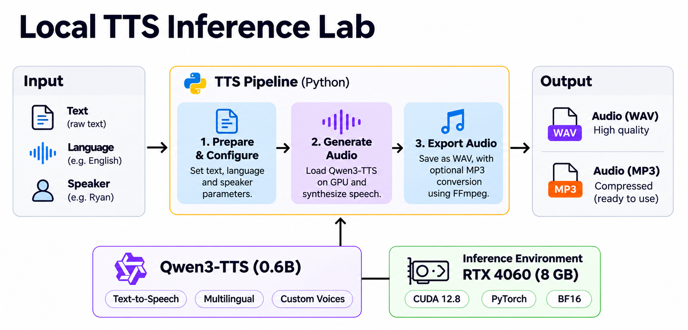

<a href="https://victorhsn.com">
  
</a>

# Local TTS Inference Lab

A reproducible local text-to-speech inference experiment using **Qwen3-TTS**, **PyTorch**, and **NVIDIA CUDA**.

The project converts text into speech using **Qwen3-TTS 0.6B CustomVoice**, running with **BF16** precision on an **NVIDIA GeForce RTX 4060 (8 GB)**. Generated audio is saved as **WAV**, with optional conversion to **MP3** using FFmpeg.



The pipeline has three stages:
1. **Prepare input**. Define the input text, language, and speaker configuration.
2. **Generate speech**. Load the **Qwen3-TTS** model onto the GPU and synthesize speech using **PyTorch** with **BF16** precision.
3. **Export audio**. Save the generated waveform as a **WAV** file, with optional **MP3** encoding through **FFmpeg**.

The experiment also collects inference metrics, including **model loading time, inference latency, audio duration, Real-Time Factor (RTF), generation speed, and peak GPU memory allocation**.

## Tested environment

| Component | Configuration |
| --- | --- |
| OS | Ubuntu Linux |
| GPU | NVIDIA GeForce RTX 4060, 8 GB |
| NVIDIA driver | 595.99.02 |
| Python | 3.12.14 |
| PyTorch | 2.11.0+cu128 |
| TTS model | `Qwen/Qwen3-TTS-12Hz-0.6B-CustomVoice` |
| Precision | `torch.bfloat16` |
| Attention | `eager` (no FlashAttention) |
| Tested language / voice | English / Ryan |
| Export | WAV and MP3 (192 kbps) |

The **CUDA 12.8** suffix identifies the PyTorch build used int he experiment; The **NVIDIA** driver reports support for **CUDA 13.2**.

## Installation

### 1. System dependencies

Install the FFmpeg and SoX:
```bash
sudo apt update
sudo apt install -y ffmpeg sox libsox-fmt-all
```

Confirm whether the GPU is visible:

```bash
nvidia-smi
```

### 2. Python environment

Use Python 3.12. The commands below assume it is available through `pyenv`:

```bash
git clone https://github.com/victorhsn/local-tts-inference-lab
cd local-tts-inference-lab
pyenv local 3.12.14
python -m venv .venv
source .venv/bin/activate
python -m pip install --upgrade pip
```

### 3. Python dependencies

Install the **CUDA 12.8 PyTorch** build, then the **TTS** and audio packages:

```bash
python -m pip install torch==2.11.0 torchaudio==2.11.0 \
  --index-url https://download.pytorch.org/whl/cu128
python -m pip install qwen-tts numpy soundfile huggingface_hub
```

The initial run used `transformers==4.57.3`. For strict reproducibility, record complete tested environment with `python -m pip freeze` and pin compatible dependency versions after validating a clean installation.

Very **CUDA** access:

```python
python -c 'import torch; print(torch.__version__, torch.cuda.is_available())'
```

### 4. Model storage

Keep the model files outside the source tree:
```bash
mkdir -p /data/models/huggingface
export HF_HOME=/data/models/huggingface
```

`HF_HOME` must be set in each new shell session, or configured in the shell environment. Now we need to download the model before running inference.

```bash
python - <<'PY'
from huggingface_hub import snapshot_download
snapshot_download(repo_id="Qwen/Qwen3-TTS-12Hz-0.6B-CustomVoice")
PY
```

The download occupies approximately **2.4GB** in the tested environment.

## Audio Sample

Generated locally using Qwen3-TTS 0.6B with the Ryan voice.

🎧 [Listen to the generated audio](./src/outputs/sample.mp3)

Execute python file:

```bash
python generate.py
```

Convert from **WAV** to **MP3**:

```bash
ffmpeg -y -i outputs/sample.wav -codec:a libmp3lame -b:a 192k outputs/sample.mp3
```

Expected output is: `outputs/sample.mp3`

## Benchmark Results

The following measurements were collected on an **NVIDIA GeForce RTX 4060** using **Qwen3-TTS 0.6** with **BF16** precision and eager attention.

### Short-form inference

| Metric | Result |
|---|---|
| Model | Qwen3-TTS-12Hz-0.6B-CustomVoice |
| GPU | NVIDIA GeForce RTX 4060 (8 GB) |
| Precision | BF16 |
| Sample rate | 24,000 Hz |
| Model loading | 4.01 s |
| Inference time | 7.12 s |
| Audio duration | 6.64 s |
| Real-Time Factor (RTF) | 1.072 |
| Generation speed | 0.93x real-time |
| Peak allocated VRAM | 2.15 GiB |
| Peak reserved VRAM | 2.23 GiB |
| Output | `outputs/sample.wav` |

### Troubleshooting

**CUDA sampling assertion with FP16**\
The first infrence attempt loaded the model but failed during generation with an invalid probability tensor (`inf`, `nan`, or negative value). It was running with `torch.float16`.

Changing to `torch.bfloat16` and starting a new Python process resolved the issue in this environment:

```python
dtype=torch.bfloat16,
attn_implementation="eager",
```

This is an observed workaround, not a general diagnosis of every **FP16** failure. A **CUDA** device-side assertion can leave the current **Python** process unusable; restart the process before retrying.

### Current limitations and next experiments
* Evaluate voice consistency across long-form chunks and section boundaries.
* Compare preset voice on the same reference passage.
* Measure pure inference time, model load time, peak VRAM, and electricity usage separately.
* Create a Markdown process
* Explore controllable voice styles and voice cloning with appropriate **Qwen3-TTS** model variants.
* Compare audio quality and operational costs with a hosted TTS API under matched conditions.

Running locally avoids a per-requested hosted TTS charge, but **does not eliminate electricity, hardware, storage, or maintenance costs**. No cost-per-minute estimate is claimed without power measurements.

## References

- [Qwen3-TTS repository](https://github.com/QwenLM/Qwen3-TTS)
- [Qwen3-TTS 0.6B CustomVoice weights](https://huggingface.co/Qwen/Qwen3-TTS-12Hz-0.6B-CustomVoice)
- [PyTorch](https://pytorch.org/)
- [FFmpeg](https://ffmpeg.org/)

Review upstream model and dependency licenses before redistribution or commercial deployment. This repository does not include model weights.